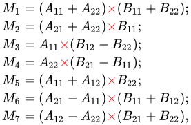
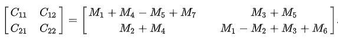

# Assignment 5: Divide and Conquer and Dynamic Programming

## The Matrix Class

File: [include/matrix.hpp](include/matrix.hpp)

```cpp
template <typename T>
class Matrix{

    // Matrix Addition
    Matrix operator+(const Matrix& other) const {};

    // Matrix Subtraction
    Matrix operator-(const Matrix& other) const {};

    // Matrix Multiplicatoin
    Matrix operator*(const Matrix& other) const {};

    // General Steps
    // - Check valid matricies 
    // - Create empty result matrix
    // - Perform element-wise operation
    // - Return result matrix
}

```

## Strassen’s Algorithm for Matrix Multiplication

```cpp
strassen_multiply(matrix) const{
    
    // Split matricies into 4 quadrants
    strassen_divide(matrix);

    // Strassens Algorithm -- creates 7 new matricies
    M1 = (A[0] + A[3]) * (B[0] + B[3]);
    M2 = (A[2] + A[3]) * B[0];
    M3 = A[0] * (B[1] - B[3]);
    M4 = A[3] * (B[2] - B[0]);
    M5 = (A[0] + A[1]) * B[3];
    M6 = (A[2] - A[0]) * (B[0] + B[1]);
    M7 = (A[1] - A[3]) * (B[2] + B[3]);

    // Combine to 4 new blocks
    C1 = M1 + M4 - M5 + M7;
    C2 = M3 + M5;
    C3 = M2 + M4;
    C4 = M1 - M2 + M3 + M6;

    // Recombine into one matrix
    return strassen_combine({C1, C2, C3, C4});
}
```




### Benchmarking

File: [src/benchmark.cpp](src/benchmark.cpp)

My approach to compare the benchmarking between the strassen algorithm vs traditional matrix multiplication was to test matricies of different sizes: `{10, 100, 1000, 2000, 5000}` across 5 trials. Then I took the average length (in seconds) of those trials. Below are my results:

| Size | Strassen's Algorithm | Matrix Multiplication |
| --- | --- | --- |
| 10 | 0.000108 | 0.000010 |
| 100 | 0.008728 | 0.008396 |
| 1000 | 7.200750 | 8.458394 |
| 2000 | 61.282754 | 71.525193 |

## Dynamic Programming for Aligning Protein Sequences