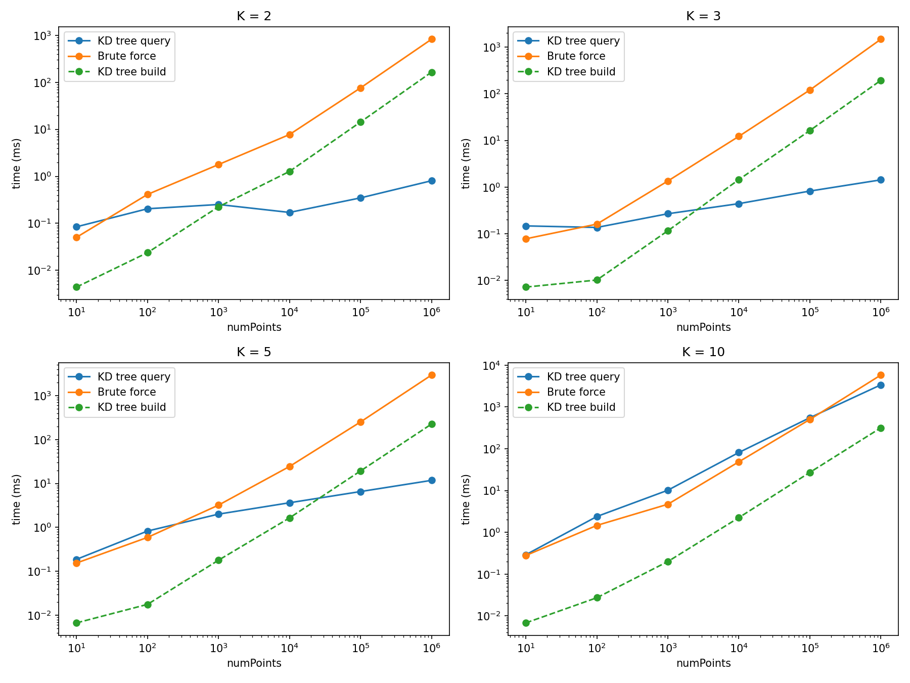

# Assignment 8: KD-Trees and Nearest Neighbor Search

## Building the KD-Tree

File: [include/kd_tree.hpp](include/kd_tree.hpp)

The KD-Tree has the following capabilities:

- Starting from an empty tree and given a list of k-dimensional points, build a K-D tree
- Given a single, k-dimensional query point, return the nearest neighbor in the K-D tree using the structure of the tree

The data structure was incrementally testing via `main.cpp` during development. An example usage is also shown in the file (commented) above the benchmarking code.

```cpp
// K-dimensional point
template <std::size_t K>
using Point = std::array<double, K>;

template <std::size_t K>
class KDTree{

    // Nodes that contain data, pointers to left and right child node
    struct Node{
        Point<K> point;
        Node* left;
        Node* right;

        // Initialize node
        Node(const Point<K>& point) : 
            point(point), left(nullptr), right(nullptr) {}
    };

    Node* root;                         // Root node
    std::vector<Point<K>> all_points;   // List of points for BF


    // Building kd-tree recursively
    Node* build_tree(std::vector<Point<K>>& points, int l, int r, int depth) {};

    // Calculate euclidean distance as a metric for closeness
    double dist_sq(const Point<K>& a, const Point<K>& b) {};
    Node* closest(const Point<K>& target, Node* a, Node*b) {};

    // Given root of kd-tree and target points, return nearest point
    Node* nearestNeighbors(Node* root, const Point<K>& target, int depth) {};

    // Destroy nodes to manage memory
    void destroy(Node* node) {};
}
```


### Quick Select Implementation (1pt Extra Credit)

File: [include/quick_select.hpp](include/quick_select.hpp)

My implementation of quick select is in reference to [wikipedia](https://en.wikipedia.org/wiki/Quickselect) and [geeks for geeks](https://www.geeksforgeeks.org/dsa/quickselect-algorithm/). Essentially, the goal of the quick select algortihm is to find the median by choosing a pivot element and moving smaller numbers to the left and bigger numbers to the right. As you balance out the numbers on each side (doesn't matter if unsorted), you have found the median. This resursive algorithm runs on average, in log n time.

### Brute force Implementation

The brute force implemntation lives in the KD-Tree class as another function. This loops over the entire list of points and files the nearest point based on distance.


```cpp
/** Find the point in the tree closes to target, using brute force
 * 
 * @param points: all points 
 * @param target: target point
 * 
 * @return closest point
 */
Point<K> nearestBF(const Point<K>& target){

    // check empty list
    if (all_points.empty())
        throw std::out_of_range("Tree is empty.");

    Point<K> best = all_points[0];

    for (std::size_t i = 1; i < all_points.size(); i++){
        // call closest with point params
        best = closest(target, all_points[i], best);
    }

    return best;
}
```

## Benchmarking Infrastructure

File: [include/benchmark.hpp](include/benchmark.hpp)

The goal is to compare the KD tree data structure and brute force searching when solvign the nearest neighbor problem. I have used node dimentions of `K = {2, 3, 5, 10}`, searching over point lengths of `{10, 100, 1000, 10000, 100000, 1000000}`, and searching for 1,000 random test points. The results below are averaged over 5 runs each. The use of the destroyer node clears up memory to prevent leakage.

### Experiment Results

| K | numPoints | KD Build Time (ms) | KD Query Time (ms) | Brute Force (ms) |
|--:|--:|--:|--:|--:|
| 2 | 10 | 0.0044 | 0.0844 | 0.0504 |
| 2 | 100 | 0.0238 | 0.2043 | 0.4123 |
| 2 | 1,000 | 0.2247 | 0.2516 | 1.7817 |
| 2 | 10,000 | 1.2739 | 0.1706 | 7.7636 |
| 2 | 100,000 | 14.3317 | 0.3480 | 76.2749 |
| 2 | 1,000,000 | 164.9299 | 0.8065 | 827.5976 |

| K | numPoints | KD Build Time (ms) | KD Query Time (ms) | Brute Force (ms) |
|--:|--:|--:|--:|--:|
| 3 | 10 | 0.0072 | 0.1475 | 0.0780 |
| 3 | 100 | 0.0102 | 0.1367 | 0.1610 |
| 3 | 1,000 | 0.1159 | 0.2687 | 1.3522 |
| 3 | 10,000 | 1.4493 | 0.4425 | 12.2622 |
| 3 | 100,000 | 16.3472 | 0.8234 | 120.8086 |
| 3 | 1,000,000 | 194.6365 | 1.4316 | 1481.6258 |

| K | numPoints | KD Build Time (ms) | KD Query Time (ms) | Brute Force (ms) |
|--:|--:|--:|--:|--:|
5 | 10 | 0.0067 | 0.1874 | 0.1545
5 | 100 | 0.0177 | 0.8269 | 0.5922
5 | 1000 | 0.1794 | 2.0063 | 3.2163
5 | 10000 | 1.6475 | 3.6416 | 24.4082
5 | 100000 | 19.3115 | 6.5530 | 251.9574
5 | 1000000 | 225.7353 | 11.7831 | 2947.4568


| K | numPoints | KD Build Time (ms) | KD Query Time (ms) | Brute Force (ms) |
|--:|--:|--:|--:|--:|
10 | 10 | 0.0068 | 0.2903 | 0.2787
10 | 100 | 0.0272 | 2.3876 | 1.4625
10 | 1000 | 0.1997 | 10.1585 | 4.6914
10 | 10000 | 2.2450 | 81.2530 | 48.6349
10 | 100000 | 27.1445 | 552.4229 | 502.0915
10 | 1000000 | 316.8983 | 3381.2182 | 5805.5428

Below is a graphical representation of the data above:



From these plots, we can see that using KD-trees have a bigger effect on its optimization of compute time with lower dimensionality of points. The time difference is very drastic. As we get to higher dimensions, the appraoches begin to follow the same growth. In the `K = 10` plot, the 5th data point shows overlap of the time for either approach to find the nearest neighbor.

However, apart from all of this, no matter how big the dimensionality, the time it takes to build the tree seems to be consistent. This makes a lot of sense because we are always only selecting from a vector based off of one data point.


## AI Acknowledgement
- AI used for generating python script to plot data